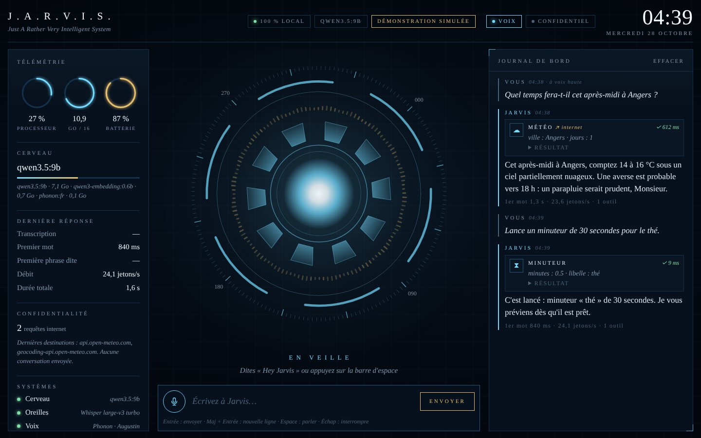
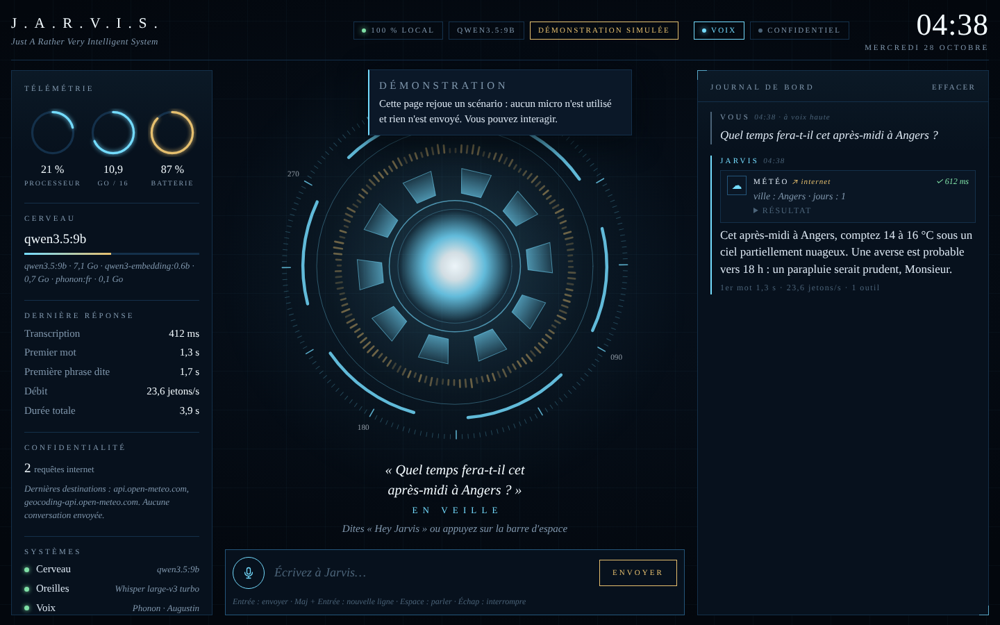
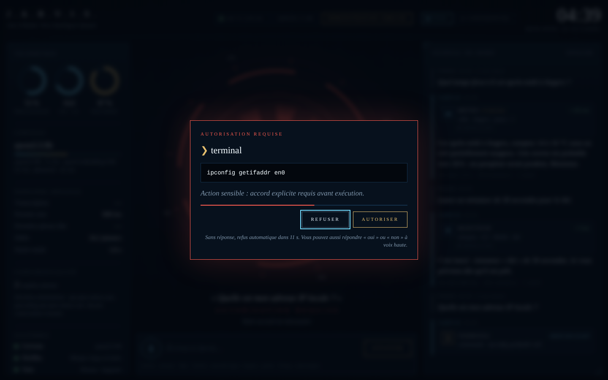
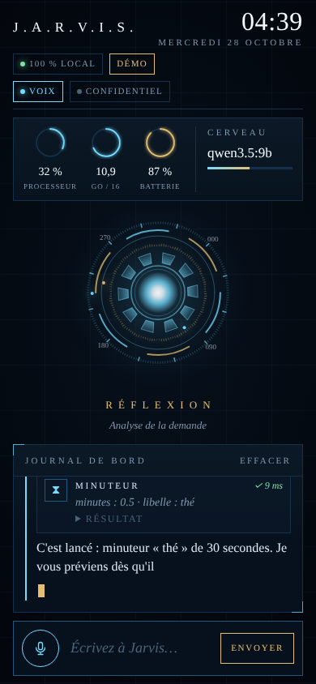
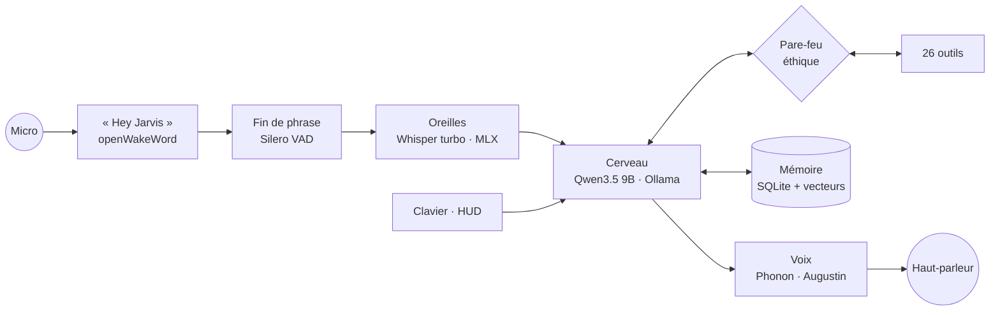

# J.A.R.V.I.S.

**Just A Rather Very Intelligent System** : ton assistant personnel, qui t'écoute, te répond à voix haute, agit sur ton Mac et se souvient de toi. Tout tourne en local, sur un Mac Apple Silicon comme sur un PC Linux : aucune conversation ne quitte ta machine.



```text
« Hey Jarvis, quel temps fera-t-il cet après-midi ? »
  ◉ écoute          Silero VAD repère la fin de ta phrase
  ◌ transcription   Whisper large-v3 turbo, sur le GPU du Mac (MLX)
  ◎ réflexion       Qwen3.5 9B choisit l'outil météo, le pare-feu l'autorise
  ♪ parole          Phonon (voix « Augustin ») commence à parler dès la première phrase
« Cet après-midi à Angers, comptez 14 à 16 °C. Une averse est probable vers 18 h :
  un parapluie serait prudent, Monsieur. »
```

| À l'écoute | Autorisation requise | Sur téléphone |
|---|---|---|
|  |  |  |

---

## Deux machines, un seul code

| | Banc d'essai | Production |
|---|---|---|
| Machine | Lenovo ThinkPad T460 · Intel Core 6ᵉ gén., 2 cœurs, 16 Go DDR3L, sans GPU utile | MacBook Air M5 · 10 cœurs, GPU avec accélérateurs IA, 16 Go unifiés à 153 Go/s |
| Cerveau | `qwen3.5:4b` · ≈ 2 à 4 jetons/s | `qwen3.5:9b` · ≈ 20 à 25 jetons/s |
| Voix et oreilles | espeak-ng · Whisper small (processeur) | Phonon « Augustin » · Whisper turbo (GPU) |
| Réponse vocale | 15 s à 1 min | ≈ 2 à 3 s |

L'installateur détecte la machine et choisit seul. Fiches techniques, calculs et explications : **[docs/MACHINES.md](docs/MACHINES.md)**.

---

## Ce que Jarvis sait faire

| Domaine | Exemples de demandes | Outils |
|---|---|---|
| Conversation | « Explique-moi la différence entre un SIEM et un XDR. » | modèle Qwen3.5 9B, en français |
| Mémoire | « Souviens-toi que mon stage commence le 2 février. » | `memoriser`, `rappeler_souvenirs`, `oublier` |
| Tes documents | « Que disent mes cours sur les Services Kubernetes ? » | `chercher_documents` (RAG local) |
| Vision | « Qu'est-ce qui cloche dans le code à l'écran ? » | `regarder_ecran` |
| Organisation | « Rappelle-moi demain à 9 h d'envoyer ma candidature. » · « Minuteur 12 minutes pour les pâtes. » | `creer_rappel`, `minuteur`, `lister_rappels`, `annuler_rappel`, `ecrire_note`, `lire_notes` |
| Pilotage du Mac | « Ouvre VS Code. » · « Mets la musique en pause. » · « Volume à 30. » | `ouvrir_application`, `controle_musique`, `regler_volume`, `notifier`, `verrouiller_ecran` |
| Presse-papiers | « Résume ce que j'ai copié. » · « Copie-moi cette réponse. » | `lire_presse_papiers`, `copier_presse_papiers` |
| Terminal | « Quelle est mon adresse IP locale ? » | `executer_commande` (toujours avec ton accord) |
| Machine | « Comment va mon Mac ? » | `etat_systeme` |
| Internet (désactivable) | « Météo à Nantes demain. » · « Qui a créé Linux ? » | `meteo`, `wikipedia`, `recherche_web`, `lire_page_web` |
| Calcul exact | « Combien font 17,5 % de 1 240 ? » | `calculer` (jamais de calcul « de tête ») |

26 outils au total. Le modèle ne fait jamais rien lui-même : il demande un outil, et le **pare-feu** de Jarvis décide.

---

## Ce qui tourne sur ton Mac



| Brique | Modèle | Disque | Mémoire vive |
|---|---|---:|---:|
| Cerveau | Qwen3.5 9B (Q4_K_M) · outils, vision, réflexion · 201 langues | 6,6 Go | ≈ 7 Go |
| Mémoire et documents | Qwen3-Embedding 0.6B | 0,64 Go | ≈ 0,7 Go |
| Oreilles | Whisper large-v3 turbo (MLX, GPU du Mac) | 1,6 Go | ≈ 1,6 Go |
| Voix | Phonon 40M français, servi par Ollama | 0,13 Go | 0,14 Go |
| « Hey Jarvis » et fin de phrase | openWakeWord + Silero VAD (ONNX, embarqués) | 6 Mo | < 50 Mo |
| Jarvis lui-même | Python, HUD | ≈ 1 Go | ≈ 0,3 Go |
| **Total** | | **≈ 10 Go** | **≈ 9,8 Go en pleine conversation** |

Sur un Mac de 16 Go, il reste environ 6 Go pour macOS, un navigateur et ton éditeur de code. Ollama décharge le modèle de mémoire après 30 minutes sans demande (réglable).

**Vitesse attendue** sur un MacBook Air M5 16 Go (estimations, `jarvis bench` mesure les tiennes) : environ 20 à 25 jetons par seconde, soit 5 fois plus vite qu'on ne parle ; moins d'une seconde de transcription ; premier son de la voix en 0,1 à 0,2 s. Entre la fin de ta phrase et le premier son : **environ 2 à 3 secondes**, un peu plus quand Jarvis doit utiliser un outil. Au lancement, Jarvis se **préchauffe** : il charge ses modèles et lit une fois pour toutes sa personnalité et ses 26 outils (≈ 3 600 jetons). Même ta première question est donc aussi rapide que les suivantes.

---

## Installation (Mac)

Il te faut un Mac Apple Silicon (M1 à M5), 16 Go de mémoire et environ 12 Go d'espace libre.

```bash
cd jarvis
bash install.sh   # vérifie la machine, installe uv et Ollama si besoin, télécharge ≈ 10 Go de modèles
jarvis            # dans un nouveau terminal : le HUD s'ouvre, dis « Hey Jarvis »
```

La commande `jarvis` n'existe qu'après l'installation : c'est `install.sh` qui la crée (dans `~/.local/bin`) et qui propose de l'ajouter à ton PATH. Le script demande avant chaque installation ou modification et se termine par un diagnostic complet. Au premier lancement, macOS te demandera d'autoriser ton terminal à utiliser le **micro** (et l'**enregistrement de l'écran** si tu demandes à Jarvis de regarder ton écran).

<details>
<summary>Installation manuelle, étape par étape</summary>

```bash
# 1. Ollama ≥ 0.40.11 (pour la voix Phonon) : https://ollama.com/download
# 2. uv, le gestionnaire Python
brew install uv
# 3. Dépendances (Python 3.12 est installé automatiquement par uv)
uv sync
# 4. Modèles
ollama pull qwen3.5:9b
ollama pull qwen3-embedding:0.6b
ollama pull phonon:fr
# 5. Configuration personnelle (~/.jarvis/config.toml)
uv run jarvis config --creer
# 6. Vérification, puis lancement
uv run jarvis doctor
uv run jarvis
```
</details>

### Tester dès maintenant sur ton Linux

Le même `bash install.sh` fonctionne sous Linux, en mode réduit. Il propose d'installer les paquets audio manquants (`libportaudio2` pour le micro, `espeak-ng` pour la voix) : la transcription passe par le processeur (faster-whisper) et la voix par espeak-ng, car Ollama ne sert la voix Phonon que sur Mac pour l'instant.

Sur un portable sans carte graphique (un ThinkPad, par exemple), tout repose sur le processeur. L'installateur le détecte et propose le modèle léger **qwen3.5:4b**, deux fois plus rapide que le 9B. Compte tout de même quelques minutes de préchauffage au lancement, puis de l'ordre de 15 secondes à une minute par réponse (estimation) : assez pour tout tester, la fluidité viendra avec le Mac.

Quand tu passeras sur le Mac, copie le dossier et relance `bash install.sh` : le code ne change pas. Tu peux copier aussi `~/.jarvis` pour garder tes souvenirs, notes et rappels ; remets alors `modele = "qwen3.5:9b"` dans `~/.jarvis/config.toml`.

---

## Utilisation

| Commande | Effet |
|---|---|
| `jarvis` | HUD + voix + « Hey Jarvis » : l'expérience complète |
| `jarvis chat` | discussion écrite dans le terminal (`--voix` pour entendre les réponses) |
| `jarvis vocal` | voix dans le terminal, sans HUD |
| `jarvis doctor` | diagnostic complet, avec la solution de chaque problème |
| `jarvis bench` | mesure les vraies performances de ton Mac |
| `jarvis index ~/Documents/ESEO` | indexe tes cours et PDF pour la recherche |
| `jarvis memoire` | affiche ce que Jarvis a retenu (`--oublier N` pour effacer) |
| `jarvis voix --essayer Lucien` | écoute une autre voix |
| `jarvis dire "Bonjour"` | fait parler Jarvis |
| `jarvis journal` | les dernières actions du journal d'audit |
| `jarvis config` | emplacement et état de la configuration |

Dans le HUD : **Entrée** envoie, **Espace** fait écouter Jarvis, **Échap** l'interrompt net (même au milieu d'une phrase). Après une réponse vocale, Jarvis t'écoute encore 5 secondes : tu peux enchaîner sans redire « Hey Jarvis ».

---

## Personnaliser

Tout se règle dans `~/.jarvis/config.toml` (créé à l'installation, chaque option y est commentée).

| Profil | Cerveau | Mémoire vive totale | Pour |
|---|---|---:|---|
| Éco | `qwen3.5:4b` (3,3 Go) | ≈ 6 Go | Mac très chargé, sur batterie |
| **Équilibré** (défaut) | `qwen3.5:9b` (6,6 Go) | ≈ 10 Go | usage quotidien |
| Max | `gemma4:12b` (7,7 Go) | ≈ 11,5 Go | réponses plus fines ; ferme les applications lourdes |

Pour changer : `ollama pull qwen3.5:4b`, puis `modele = "qwen3.5:4b"` dans la section `[cerveau]`.

**Petites astuces**

- Six voix masculines françaises : Augustin, Arnaud, Jules, Baptiste, Lucien, Marius. Écoute-les avec `jarvis voix --essayer <nom>`.
- Whisper écrit mal un nom propre ? Ajoute-le à `vocabulaire` dans `[oreilles]`.
- Jarvis se déclenche tout seul ? Monte `seuil_activation` à 0,6 ou 0,7.
- Le **mode confidentiel** (bouton du HUD) coupe tous les outils internet : pratique en réunion ou en entretien.
- Voix de secours plus naturelle : Réglages Système > Accessibilité > Contenu énoncé > Voix du système > Gérer les voix, puis télécharge « Thomas (Améliorée) ».

---

## Sécurité et vie privée

- **100 % local** : le cerveau, les oreilles et la voix tournent sur ta machine. Seuls les outils internet (météo, Wikipédia, recherche) envoient une requête, comptée et affichée dans le HUD.
- **Pare-feu éthique** : trois niveaux de risque. Les actions sensibles (terminal, oubli) demandent ton accord ; les commandes destructrices (`sudo`, formatage, `rm -rf /`, `curl | sh`…) sont refusées d'office.
- **Garde-fou anti-fuite** : si des données privées (presse-papiers, notes, écran, terminal) sont lues pendant une demande, tout envoi vers internet dans cette même demande doit être validé par toi.
- **Défense contre l'injection de prompt** : le contenu d'une page web ou d'un document est encadré comme une donnée, jamais comme une consigne.
- **HUD verrouillé** : serveur sur 127.0.0.1 uniquement, jeton secret, vérification de l'origine du WebSocket, politique de sécurité du contenu à base d'empreintes SHA-256.
- **Journal d'audit** de chaque action (`jarvis journal`), données personnelles dans `~/.jarvis` (droits 700), jamais dans le dossier du code.

Le détail, avec les limites connues : [docs/SECURITE.md](docs/SECURITE.md).

---

## Comprendre comment ça marche

[docs/COMPRENDRE.md](docs/COMPRENDRE.md) suit une phrase du micro jusqu'au haut-parleur et explique chaque brique : le mot d'activation, la détection de parole, Whisper, la boucle agent, les appels d'outils, les embeddings, le RAG, la quantification, le cache de préfixe. Il se termine par des exercices pour faire évoluer Jarvis toi-même.

```text
jarvis/
├── install.sh                    installation guidée
├── jarvis/
│   ├── brain.py                  la boucle agent (modèle ⇄ outils ⇄ pare-feu)
│   ├── persona.py                la personnalité et le contexte de chaque demande
│   ├── llm.py                    client HTTP minimal pour Ollama
│   ├── security.py               pare-feu, garde-fou anti-fuite, journal d'audit
│   ├── memory.py                 mémoire à long terme (embeddings + SQLite)
│   ├── knowledge.py              recherche dans tes documents (RAG)
│   ├── scheduler.py              rappels et minuteurs persistants
│   ├── assistant.py              chef d'orchestre (file, états, confirmations)
│   ├── tools/                    les 26 outils, un fichier par domaine
│   ├── voice/                    micro, « Hey Jarvis », VAD, Whisper, voix
│   ├── hud/                      serveur local sécurisé + interface
│   ├── doctor.py · bench.py      diagnostic et mesures
│   └── assets/                   modèles ONNX embarqués, configuration exemple
├── tests/                        138 tests, dont un faux serveur Ollama
└── docs/                         guide, machines, sécurité, captures
```

---

## Dépannage

| Symptôme | Solution |
|---|---|
| `zsh: command not found: jarvis` | La commande est créée par l'installation : lance `bash install.sh` depuis le dossier qui contient `install.sh`, puis ouvre un nouveau terminal. Si tu as refusé l'ajout au PATH : `~/.local/bin/jarvis`. |
| Réponses très lentes sur un PC sans carte graphique | Passe au modèle léger : `ollama pull qwen3.5:4b`, puis `modele = "qwen3.5:4b"` dans `~/.jarvis/config.toml`. Encore plus rapide, mais moins fiable : `qwen3.5:2b`. |
| « Hey Jarvis » ne réagit pas | `jarvis doctor` vérifie le signal du micro ; autorise ton terminal dans Réglages Système > Confidentialité et sécurité > Micro. |
| La voix est celle de macOS, pas Augustin | Ollama doit être en 0.40.11 ou plus, puis `ollama pull phonon:fr`. |
| Réponses lentes | Demande « Comment va mon Mac ? » : si la mémoire d'échange grimpe, passe au profil Éco. |
| « Le port 7777 est déjà utilisé » | Jarvis tourne déjà, ou lance `jarvis --port 7778`. |
| Jarvis ne voit pas ton écran | Autorise ton terminal dans Réglages Système > Enregistrement de l'écran. |
| Tout effacer | `rm -rf ~/.jarvis` supprime mémoire, notes, rappels et journal. |

## Tests

```bash
uv run pytest        # 138 tests, environ 25 secondes, sans micro ni modèle réel
```

Les tests utilisent un faux serveur Ollama qui parle exactement le même protocole (flux NDJSON, appels d'outils, audio PCM). Le détecteur « Hey Jarvis » est vérifié sur un vrai enregistrement, et sa réimplémentation donne des scores identiques à ceux d'openWakeWord.

## Licences des modèles

Ton code peut prendre la licence de ton choix. Les modèles ont les leurs : Qwen3.5 et Qwen3-Embedding (Apache 2.0), Whisper (MIT), Silero VAD (MIT), openWakeWord (code Apache 2.0, modèle « hey jarvis » CC BY-NC-SA 4.0), **Phonon 40M français (CC BY-NC 4.0)**. Les deux licences « NC » autorisent un usage personnel, pas commercial. Détails : [THIRD_PARTY.md](THIRD_PARTY.md).
